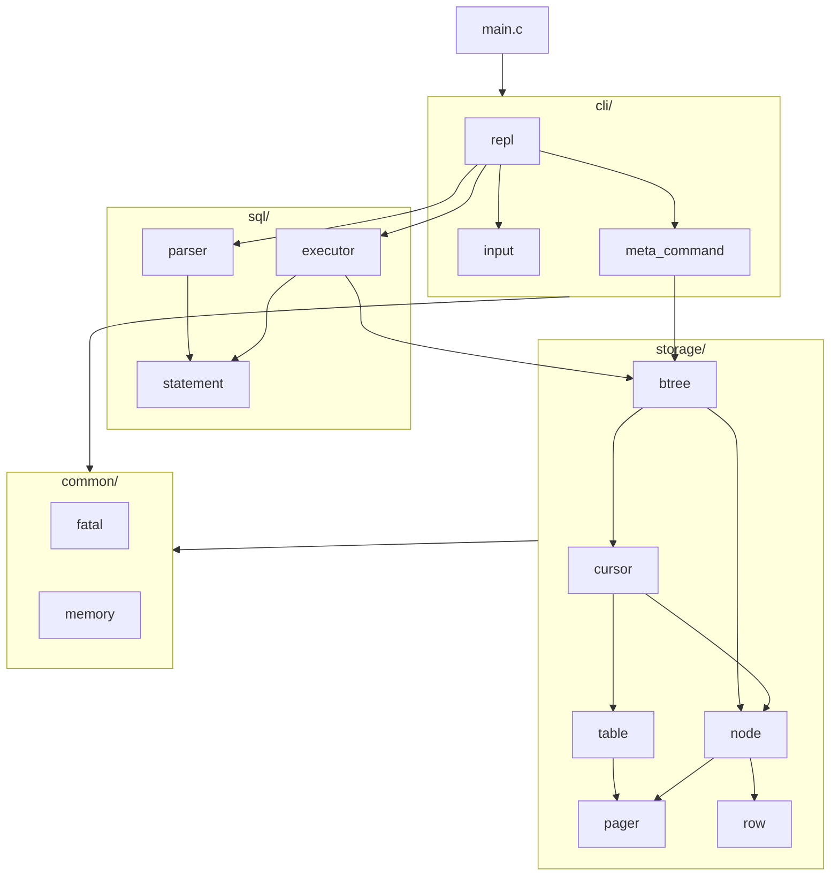

# Architecture

`c-database` is split into four layers. Each layer only includes headers from the layers below it.

## Modules

### `common/`

| File       | Responsibility |
| ---------- | -------------- |
| `fatal.h`  | `fatal(fmt, ...)` prints `Fatal: <message>` to `stderr` and exits. It is only used for unrecoverable conditions: I/O failures, a corrupt file, or a broken tree invariant. |
| `memory.h` | `xmalloc` / `xcalloc`: allocation that never returns `NULL`. |

### `storage/`

| File       | Responsibility |
| ---------- | -------------- |
| `row.h`    | The `Row` struct and its fixed-width binary encoding (`row_serialize`, `row_deserialize`). |
| `pager.h`  | Maps page numbers to 4 KiB buffers. Loads pages lazily from disk, hands out new pages (`pager_allocate_page`), and writes every cached page back in `pager_close`. |
| `node.h`   | The on-disk node layout as compile-time constants, plus getters and setters for every header and cell field. All multi-byte fields are read and written with `memcpy`, because the layout puts them at unaligned offsets. |
| `table.h`  | Opens and closes a database file. Turns page 0 into an empty root leaf when the file is new. |
| `cursor.h` | A `Cursor` is a value type pointing at one cell in a leaf. `cursor_find` descends from the root to the leaf where a key is (or would be). `cursor_advance` follows the leaf sibling chain. |
| `btree.h`  | Insertion, including leaf and internal splits and root promotion, the free-page check before an insert, and the `.btree` printer. |

### `sql/`

| File          | Responsibility |
| ------------- | -------------- |
| `statement.h` | The `Statement` produced by the parser. |
| `parser.h`    | Splits input on whitespace, checks the field count, parses `id` with `strtoll`, and enforces the column widths. Returns a `PrepareResult`. |
| `executor.h`  | Runs a `Statement` against a `Table`. Returns an `ExecuteResult`. |

### `cli/`

| File             | Responsibility |
| ---------------- | -------------- |
| `input.h`        | A growable line buffer on top of `getline`. Strips `\n` and `\r\n`, and reports end of input. |
| `meta_command.h` | A table of dot-commands, each mapped to a handler. `.exit` returns `META_COMMAND_EXIT` instead of calling `exit()`, so the REPL can shut down cleanly. |
| `repl.h`         | The read–prepare–execute loop. It is the only place that turns result codes into user-facing messages. |

## Request lifecycle

### `insert 7 alice alice@example.com`

1. `repl_run` reads the line and sees it isn't a meta-command.
2. `prepare_statement` tokenizes it, checks that there are exactly four fields, parses the id, checks
   the column lengths, and fills `Statement.row_to_insert`.
3. `execute_insert`:
   1. `cursor_find(table, 7)` walks the internal nodes, binary-searching each one's keys, down to a
      leaf, then binary-searches the leaf.
   2. If `cursor_points_at_key` is true, it returns `EXECUTE_DUPLICATE_KEY`.
   3. `btree_has_room_for_insert` walks up from the target leaf and counts the full nodes. Each full
      node will split and needs one new page, and a full root needs one more. If the pager can't
      supply that many pages, it returns `EXECUTE_TABLE_FULL`. Nothing has been changed at that point.
   4. `btree_insert` writes the cell, splitting nodes if needed.
4. The REPL prints `Executed.`.

### `select`

`cursor_start` positions at the left-most cell (via `cursor_find(table, 0)`).
`cursor_advance` steps through each leaf and then follows `next_leaf` to the next one, so rows come
out in key order without going back up through internal nodes.

## B+ tree algorithms

### Leaf split

When a leaf already holds `LEAF_NODE_MAX_CELLS` (13) cells:

1. Allocate a new leaf and insert it into the sibling chain right after the old leaf.
2. Spread the 14 cells (13 existing plus the new one) so the lower 7 stay in the old leaf and the
   upper 7 go to the new leaf. The new cell is written straight into its final slot.
3. If the old leaf was the root, **create a new root**. Otherwise, refresh the parent's key for the
   old leaf (its maximum key has dropped) and insert the new leaf into the parent.

### Creating a new root

The root always stays on page 0, so a table never has to track where its root is:

1. Copy the old root into a newly allocated page. That copy becomes the left child, and its children
   are re-pointed to it.
2. Re-initialize page 0 as an internal node with one key, the left child's maximum. The left child
   goes in slot 0 and the split-off node becomes the right child.

### Internal node insert

An internal node with `n` keys has `n + 1` children: `n` (child, key) cells plus a separate right
child. Every key equals the largest key in its child's subtree. The right child has no key, because
its maximum is the node's maximum.

- If the node is empty (right child is `INVALID_PAGE_NUM`), the new child becomes the right child.
- If the new child's maximum is above the current right child's, the old right child moves into a
  regular cell and the new child becomes the right child.
- Otherwise, the cells shift right and the new child goes in at the position found by binary search.

Every insert also sets the child's parent pointer, so parent pointers are always correct, even when
the insert causes a split higher up.

### Internal node split

When an internal node is already full (`INTERNAL_NODE_MAX_KEYS`, which is 3):

1. Allocate a sibling. If the node being split is the root, first create a new root, so the node's
   contents move to a fresh left page.
2. Move the right child and the upper cells into the sibling. The highest remaining cell's child
   becomes the old node's right child.
3. Insert the pending child into whichever half covers its key range.
4. Refresh the parent's key for the old node, and insert the sibling into the parent. That may split
   the parent as well.

`INVALID_PAGE_NUM` (`UINT32_MAX`) marks an empty right child. Page 0 can't be used for this, because
page 0 is a real page: the root.

## Error-handling model

| Kind | Mechanism | Example |
| ---- | --------- | ------- |
| User error | Result enum, shown by the REPL | duplicate key, string too long, table full |
| Environment error | `fatal()` | `open`/`pread`/`pwrite` failure, file not a whole number of pages |
| Broken invariant | `fatal()` | asking for a child index that doesn't exist |

User errors never change the tree. Because the table-full check runs before any write, a full table
rejects the insert cleanly and the existing data is still saved on exit.
